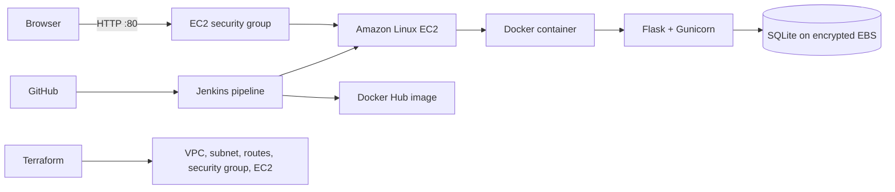

# EventPass - DevOps capstone

A small event-ticketing app and repeatable AWS deployment used for the Module 14 capstone. Students can browse seeded events, reserve a ticket, see the ticket count decrease, and add events in the organizer view. Checkout is simulated; no payment details are collected.

## What students will deploy



The default teaching deployment uses **one small EC2 instance and SQLite on its encrypted disk**. It avoids paid load balancers, NAT gateways, and managed databases while still demonstrating VPC networking, security groups, EC2, Terraform, Docker, GitHub, Jenkins, and CloudWatch. AWS charges vary by account, region, and current free-tier eligibility. Stop or destroy the instance after each class.

This is a classroom demo, not a production ticketing platform. It has no real payments, user accounts, admin authentication, high availability, or production database. Do not put real customer data on it. The organizer page is intentionally simple for the lab.

## Local preview

Prerequisites: Docker Desktop with Docker Compose.

```powershell
docker compose up --build
```

Open [http://localhost:8080](http://localhost:8080). Try reserving a ticket, then use **Organizer view** to add an event and see bookings. Data persists in a Docker volume. Stop the local app with `Ctrl+C`, then run `docker compose down` when you want to remove its container (the named data volume remains until explicitly removed).

## One-time AWS preparation

You need Terraform, AWS CLI, SSH/SCP, and an AWS identity with permission to create VPC, subnet, route table, internet gateway, security group, and EC2 resources. Set up AWS CLI credentials using an IAM role/user intended for learning; do not commit credentials.

1. In the AWS console, create or select an EC2 key pair in the region you will use. Keep its private key file safe.
2. Find your current public IPv4 address and write it as `x.x.x.x/32`.
3. Copy `terraform/terraform.tfvars.example` to `terraform/terraform.tfvars` and fill in the key pair name and your IP range. The real tfvars file is ignored by Git.
4. From the `terraform` folder, run:

   ```powershell
   terraform init
   terraform plan
   terraform apply
   ```

   Review the plan and type `yes` only when it shows the expected demo resources. The output includes `app_url` and `instance_public_ip`.
5. Wait about 2-3 minutes for EC2 user data to install Docker. From the repository root, deploy the app:

   ```powershell
   .\scripts\deploy.ps1 -HostIp <instance_public_ip> -KeyPath <path_to_private_key.pem>
   ```

6. Open the output URL. A successful visit to `/health` returns `{"status":"ok","service":"eventpass"}`.

For cleanup, from `terraform`, run `terraform destroy` and review the plan before confirming. This deletes the VPC and EC2 instance. Save anything you want to keep first. Terraform state is local and ignored; keep it private and do not lose it while infrastructure is running.

## Classroom flow (4 hours)

1. **0:00-0:25 - App tour:** show the event listing, reserve a ticket, organizer view, and health endpoint.
2. **0:25-1:10 - Terraform:** inspect the VPC, subnet, internet gateway, route, security group, and EC2; plan and apply.
3. **1:10-1:45 - Docker:** read the Dockerfile, build and run locally, inspect logs and persistent volume.
4. **1:45-2:25 - AWS deployment:** run the deploy script, browse the EC2-hosted app, and inspect EC2 status checks and CloudWatch instance metrics.
5. **2:25-3:25 - Jenkins CI/CD:** connect a Jenkins job to this GitHub repository; configure credentials and run the provided pipeline (details below).
6. **3:25-4:00 - Change and redeploy:** change an event or page heading, commit/push, observe the pipeline, and verify the change in the browser.

If Jenkins is not already available in the lab, skip that section and demonstrate the same image build/deploy steps locally. Avoid spending class time installing Jenkins from scratch.

## Jenkins setup (optional in the first run)

Jenkins needs Docker CLI access to a Docker daemon, Git, and the **SSH Agent** plugin. Use a trusted, isolated classroom Jenkins controller/agent. In Jenkins, configure:

- Environment variable `DOCKERHUB_USER` with your Docker Hub username.
- Username/password credential ID `dockerhub`; use a Docker Hub access token as the password.
- Secret text credential ID `eventpass-host` containing the EC2 public IPv4 address.
- SSH private key credential ID `eventpass-ec2-key`, username `ec2-user`, using the same EC2 key pair.
- A Pipeline job pointing at this repository's `Jenkinsfile`, triggered by a GitHub webhook or manually.

Allow SSH from the Jenkins agent's public IP by changing `instructor_ip_cidr` before Terraform apply. Never open SSH to `0.0.0.0/0`. The pipeline uses a build-number image tag, pulls that image on EC2, and replaces the running container while preserving the SQLite data directory.

## Suggested class demo

- Open the app and reserve one ticket. Show the confirmation code and reduced availability.
- Open `/admin` to add an event and list recent bookings.
- Visit `/health` to show a simple service health check.
- Change a heading, push to GitHub, watch Jenkins build and publish an image, then refresh the app.
- In AWS, trace the browser request through the security group to EC2. Review EC2 CPU/network metrics in CloudWatch and the Docker container logs over SSH.

## Repo map

| Path | Purpose |
| --- | --- |
| `app/` | Flask event listing, booking, organizer page, and health endpoint |
| `Dockerfile`, `docker-compose.yml` | Container build and local preview |
| `terraform/` | Low-cost AWS classroom infrastructure |
| `scripts/deploy.ps1` | Initial Windows-to-EC2 deployment |
| `Jenkinsfile` | Build, publish, and deploy pipeline |
| `docs/INSTRUCTOR_RUNBOOK.md` | Instructor checklist and troubleshooting |

## Next learning extension

After the basic capstone works, students can propose a production-style variant with an Application Load Balancer, Auto Scaling, private app/database subnets, RDS, S3/CloudFront, Route 53/ACM, and SQS/SNS. Those services add cost and setup, so they are deliberately not in the default four-hour deployment.
